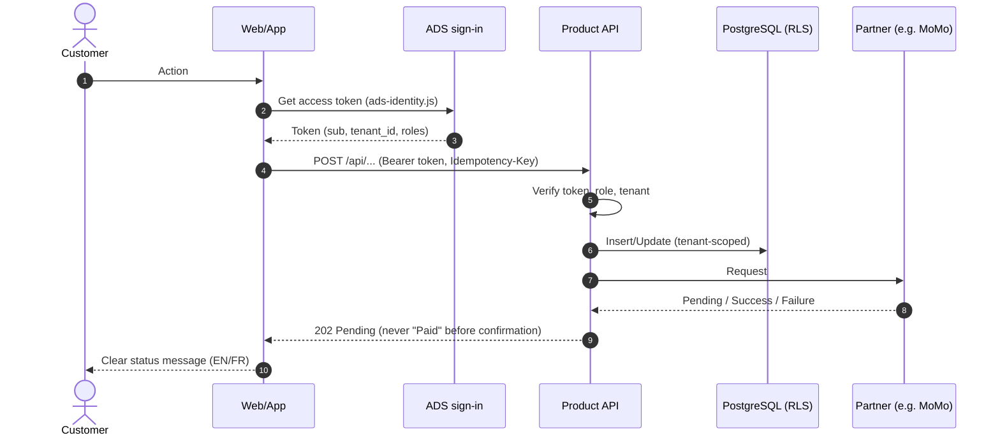

# Sequence: <journey or story>

Traces to: US-<id>, FR-<id>

Failure paths to show: invalid token (401), missing role (403), other tenant (404/403), partner timeout (stays Pending), validation error (400).
