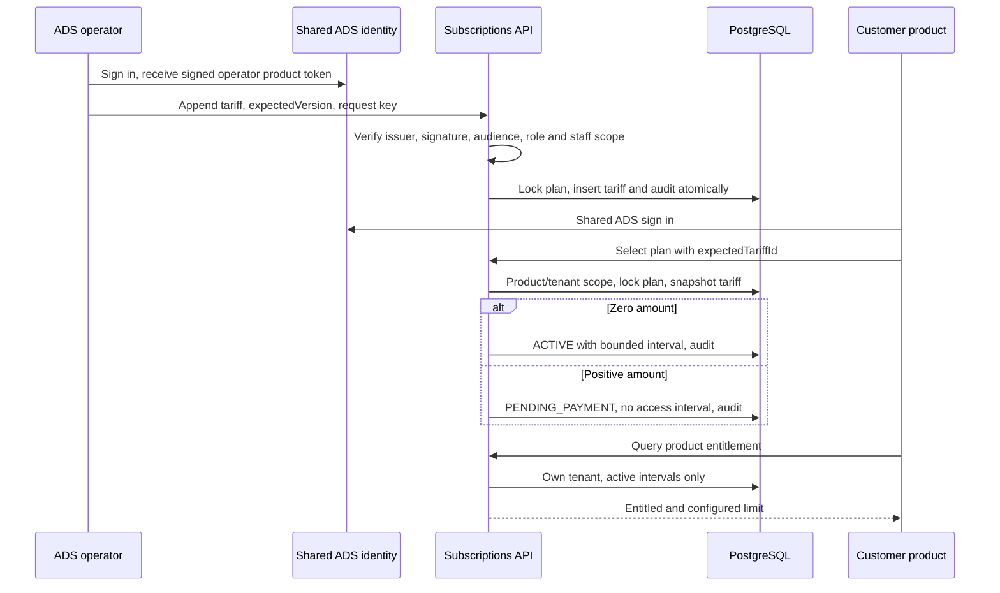

# SH-1-S01 design and decisions

## Reconciliation

Kit main `d76980d` has identity, mock providers and business opportunities, but no shared subscription service. Identity's `src/admin.mjs` verifies ADS tokens with jose RS256/JWKS, audience and expiry; this service follows that existing verification contract. Education's `src/server/mvp/entitlements.ts` (blob `004189ef5512c8b9fd37c12d1ddc458943535454`) exposes one provider interface, tenant-scoped effective capabilities and fail-closed missing capability behavior. Reuse those boundaries, not Education tables or business defaults. There is no override/partner tree in this first slice.

## ADR: product-neutral catalogue, tenant-private grants

Plans and immutable tariff versions are shared catalogue data readable only in the authenticated product. Configured ADS operators may create catalogue entries across the configured products; operator role alone, a staff claim alone, or an arbitrary staff tenant alone is insufficient. Subscription grants, request replay evidence and audit are scoped by tenant/product and signed subject. Runtime uses NOBYPASSRLS and column-level grants; startup rejects privileged runtime logins. No service-role bypass substitutes for customer context.

Database migration 001 creates `ads_subscriptions.plans`, `tariffs`, `subscriptions`, `audit` and `requests`, all with forced RLS. The migration ledger in `public.ads_subscription_migrations` is migration-owner metadata with no runtime grants. Plans reference append-only tariff versions. Subscriptions hold a tariff FK and immutable public terms snapshot; private eligible-organisation IDs are excluded from the customer snapshot. Direct database insertion checks the real snapshot, effective tariff, eligibility and zero-cost activation rule. Runtime may cancel a subscription but cannot edit terms or start/end dates. SH-2 will require a separately reviewed atomic activation boundary.

## Concurrency and money

The replay key includes tenant, user, product and operation, guarded by a transaction advisory lock. Tariff creation and subscription selection share a per-plan transaction lock and optimistic configuration version. Subscription creation writes its immutable selected terms and audit in the same transaction. A crash cannot leave an unaudited grant. Tariffs/audit/replay evidence have no runtime UPDATE/DELETE grants and append-only triggers.

Eligibility is evaluated against the latest effective tariff, not the latest eligible old tariff. Existing subscriptions are not rewritten by later tariff changes. Access interval is inclusive at `starts_at` and exclusive at `ends_at`. Pending payment has no dates and grants nothing; cancellation removes access. Seven-day expiring state is a display projection in this foundation, not reminder delivery. No online charge, paid activation, refund, or sponsor money collection occurs.

## Sequence

## Operational boundaries

Token revocation follows current ADS access-token expiry; no new introspection endpoint exists. Short-lived signed token authorisation can therefore remain valid until expiry after an identity role revocation. Database connections use transaction-local scope to prevent pool leakage. Product/audience binding is one-to-one; caller tenant overrides and foreign entitlement namespaces are rejected.

Migrate using separate owner credentials. Normal rollback is to stop the new API and restore the previous application configuration while retaining append-only evidence. Never drop the schema during an ordinary rollback. Any later correction is a forward migration. A database restore requires a verified backup and explicit release-owner procedure after preserving evidence; no destructive rollback script is supplied. Containers/backup restore/hosted tests are not verified in this slice.
